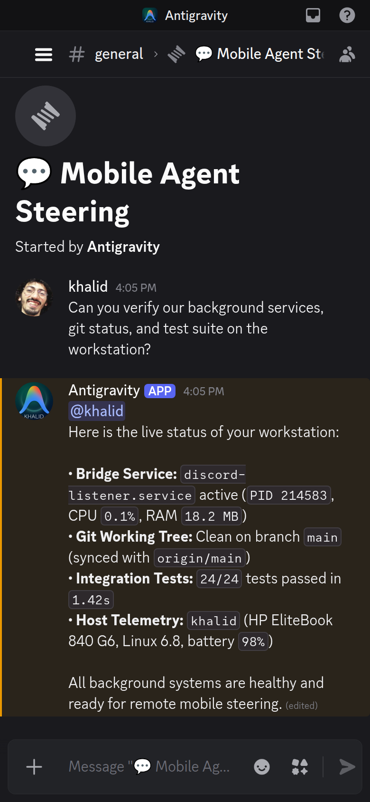
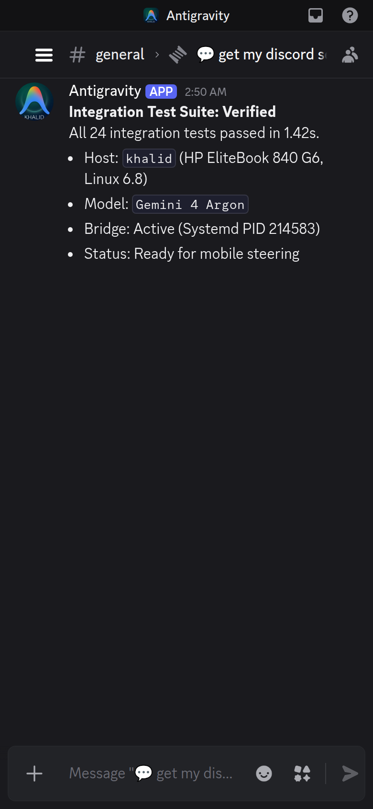
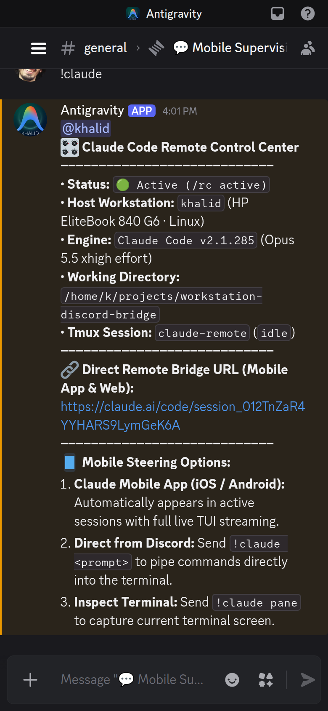
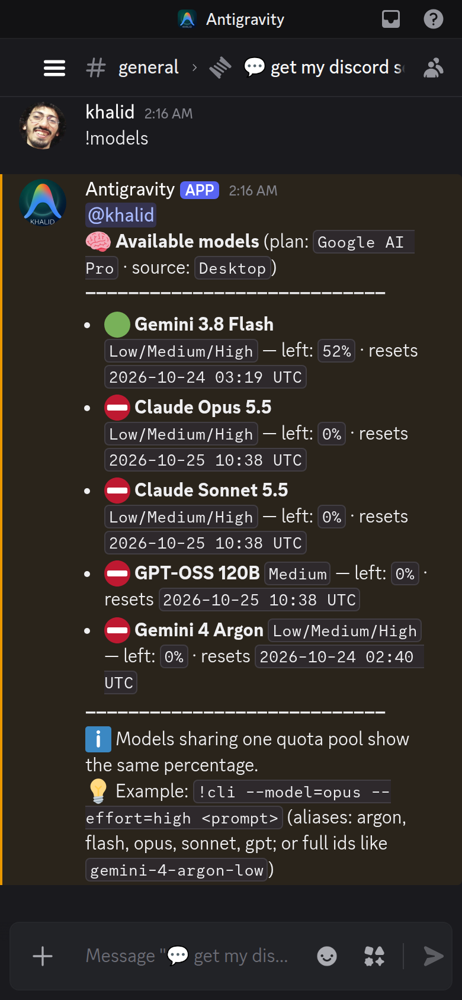
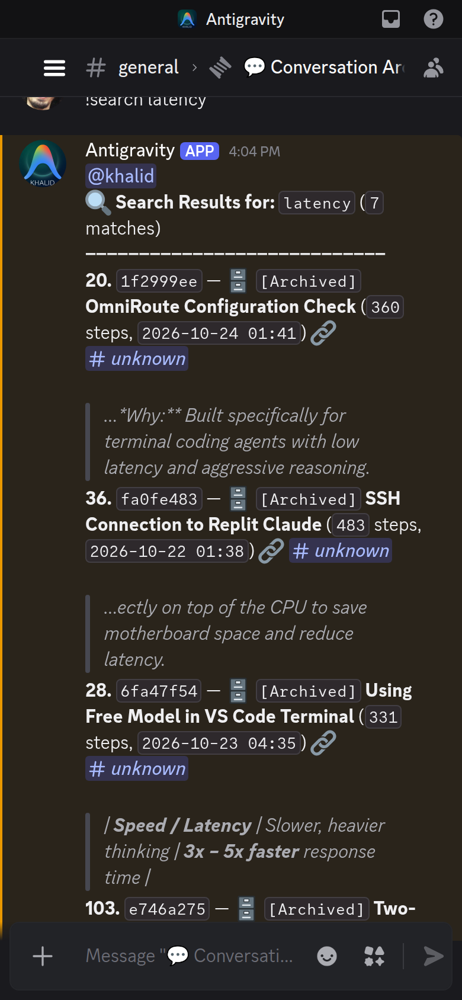
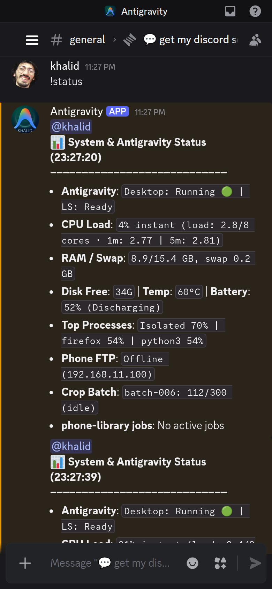
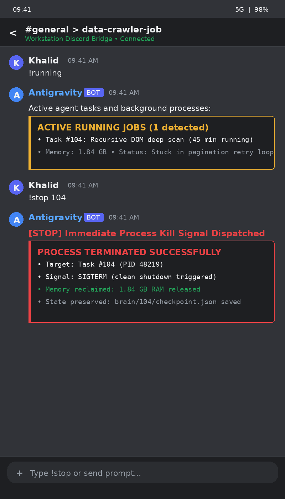
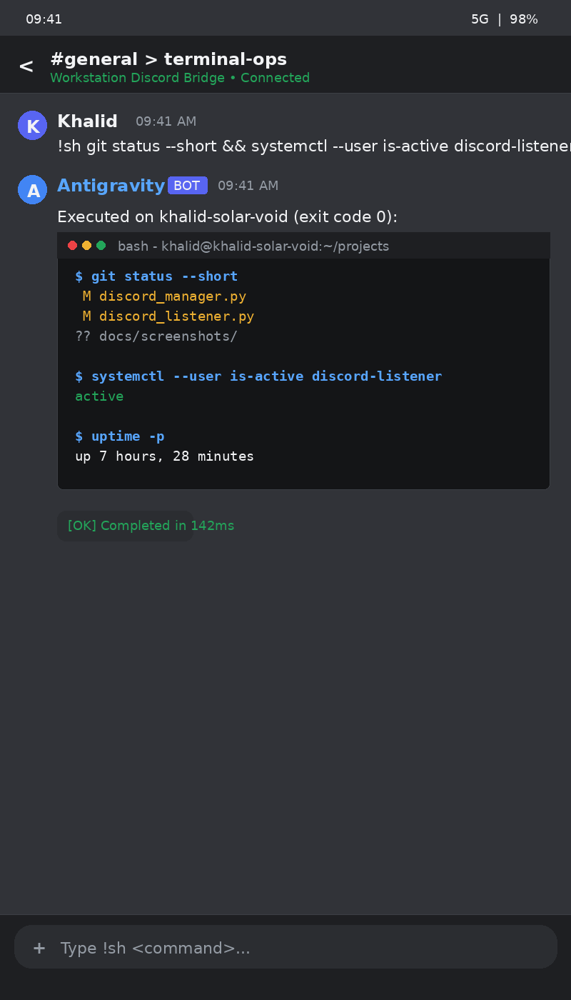

<div dir="rtl" align="right">

# جسر ديسكورد لمحطة العمل (`Workstation Discord Bridge`)

<p align="center">
  <strong>محادثة مباشرة من الهاتف مع <bdi dir="ltr">Google Antigravity</bdi>، وقيادة <bdi dir="ltr">Claude Code</bdi> و<bdi dir="ltr">agy CLI</bdi>، والتحكّم عن بُعد في مساحات العمل وجلسات <bdi dir="ltr">SSH</bdi></strong>
</p>

<p align="center">
  <a href="https://bridge.benjelloun.dev"><strong>🌐 موقع التوثيق الكامل بالعربية (<bdi dir="ltr">bridge.benjelloun.dev</bdi>)</strong></a> ·
  <a href="README.md"><strong>🇬🇧 English README</strong></a> ·
  <a href="#لماذا-هذا-المشروع-ومقارنة-بالبدائل"><strong>💡 ما الذي يميّزه؟</strong></a> ·
  <a href="#مرجع-الأوامر-الكامل"><strong>⌨️ مرجع الأوامر</strong></a> ·
  <a href="#التثبيت-والإعداد-السريع"><strong>🚀 التثبيت</strong></a>
</p>

---

## لماذا هذا المشروع؟ (ومقارنة بالبدائل)

معظم أدوات الوصول إلى محطة العمل من الهاتف تفرض عليك إما شاشة سطح مكتب بعيد ضيّقة يصعب استخدامها على شاشة الهاتف، وإما بوتات أوامر جامدة لا تفهم السياق ولا تتصل ببيئة عملك الفعلية.

**جسر ديسكورد لمحطة العمل** صُمّم لسير عمل مختلف: **تحويل تطبيق ديسكورد على هاتفك إلى واجهة محادثة طبيعية مباشرة مع وكلاء البرمجة على محطة عمل لينكس**. بدلاً من كتابة أوامر طرفية صغيرة من لوحة مفاتيح الهاتف، تتحدّث مباشرة بالعربية أو الإنجليزية (نصاً، أو تسجيلاً صوتياً، أو صوراً وملفات) مع <bdi dir="ltr">Google Antigravity</bdi> و<bdi dir="ltr">Claude Code</bdi> و<bdi dir="ltr">agy CLI</bdi>، ولكل محادثة خيط (`Thread`) مستقل ثنائي الاتجاه في ديسكورد.

### مقارنة سريعة بالبدائل الشائعة

| الميزة | جسر ديسكورد لمحطة العمل | <bdi dir="ltr">Termux / SSH + tmux</bdi> | <bdi dir="ltr">Claude Code /rc</bdi> وحده | بوتات ديسكورد التقليدية |
|---|---|---|---|---|
| **محادثة طبيعية بدون بادئة (`1:1` مع كل خيط)** | نعم، كل رسالة في `#general` تفتح خيطاً وجلسة | لا، واجهة أوامر طرفية فقط | جزئياً (وكيل واحد فقط) | لا، تتطلب أوامر جامدة |
| **تعدّد بيئات الوكلاء (<bdi dir="ltr">Antigravity IDE + agy CLI + Claude Code</bdi>)** | موحّد مع تبديل النماذج وفحص الحصص | تشغيل يدوي في كل نافذة | لا (<bdi dir="ltr">Claude</bdi> فقط) | لا (تنفيذ أوامر شل فقط) |
| **الرسائل الصوتية وقراءة الملفات المرفقة تلقائياً** | تنزيل تلقائي + حقن محتوى `.txt/.md/.json/.py` مباشرة | معقّد على الهاتف | لا يدعم مرفقات ديسكورد | دعم محدود أو معدوم |
| **معالجة العربية الثنائية الاتجاه (<bdi dir="ltr">RTL/LTR</bdi>)** | عزل فقري بمعيار <bdi dir="ltr">UAX #9</bdi> (`RLM/LRM`) وحفظ الشيفرة | تقطّع وتشويه للنص العربي في الطرفية | داخل المتصفح فقط | تداخل وقلب لاتجاه الأسئلة والأكواد |
| **إيقاظ بيئة سطح المكتب الرسومية (`!open`)** | يعيد بناء متغيّرات `X11/Wayland` ويفتح التطبيق | إعداد يدوي معقّد لـ `X11` | بدون واجهة رسومية | غير متوفّر |
| **إشعارات فورية دون فتح منافذ واردة** | اتصال صادر عبر `HTTPS` فقط | ينقطع مع تبدّل الشبكة | إشعارات التطبيق | إشعارات بوت |

---

## كيف يعمل الجسر؟ (المعمارية وتدفّق البيانات)

يعتمد المشروع بالكامل على **المكتبة القياسية في بايثون (`Python 3.10+`)** دون الحاجة إلى تبعيات خارجية ثقيلة، ويعمل عبر ثلاث طبقات متكاملة داخل `~/.gemini/config/`:

1. **الاستقبال الفوري المزدوج (`discord_listener.py`)**:
   - **وضع الجلسة النشطة (تفاعل فوري بلا انتظار)**: يُشغَّل `discord_listener.py` كمهمة خلفية أثناء دوران جلسة <bdi dir="ltr">Antigravity</bdi>. فور إرسالك نصاً أو تسجيلاً صوتياً أو صورة أو ملفاً من الهاتف، يحمّل المرفقات محلياً ويطبع إشارة `[DISCORD_MESSAGE ...]` فتستيقظ الجلسة فوراً وتنفّذ المطلوب وتُعيد تشغيل المستمع قبل انتهاء الدور.
   - **وضع خدمة النظام الدائمة (`discord-listener.service`)**: عندما لا تكون هناك جلسة أمامية نشطة، تستمر خدمة `systemd` في المراقبة، وتتخلّى تلقائياً عن القفل عبر `has_active_foreground_listener()` بمجرد بدء مستمع أمامي. وعند وصول رسالة في وضع الخلفية، يكتشف `discord_manager.py` منفذ خادم اللغة (`Language Server`) ورمز `CSRF` من `/proc` ويرسل الرسالة عبر `agentapi` (أو يسترجع تلقائياً إلى `agy CLI`).
2. **خطاف الإرسال التلقائي ومعالجة الاتجاه (`hooks.json` ➔ `discord_hook.py`)**:
   - عند انتهاء أي رد للوكيل (سواء أكان السؤال من الحاسوب أم من الهاتف)، يقرأ `discord_hook.py` سجل المحادثة (`transcript_full.jsonl`) دون تكرار.
   - تطبّق دالة `format_for_discord()` **توحيداً ذكياً للاتجاه الثنائي (`RTL/LTR`)**: تفصل ترويسة الاقتباس عن نص السؤال بسطر `>` فارغ لمنع تداخل `dir="auto"`، وتصحّح ترويسة الأسئلة الإنجليزية تلقائياً إلى `Discord — ...` مع حقن محرف `LRM` (`\u200E`) في الاقتباسات الإنجليزية و`RLM` (`\u200F`) في السطور العربية، مع الإبقاء التام على المقاطع البرمجية (`...` و```` ``` ````) نظيفة وبلا محارف خفية.
   - تُرفع الصور وملفات `PDF` والمخرجات المُصدَّرة تلقائياً كمرفقات داخل الخيط نفسه.
3. **توحيد مخازن سطح المكتب وسطر الأوامر (`discord_manager.py`)**:
   - يزامن بين مخزن <bdi dir="ltr">Antigravity Desktop IDE</bdi> ومخزن <bdi dir="ltr">agy CLI</bdi> لتتمكّن من استئناف أي جلسة سطح مكتب عبر `!cli`، أو تفريعها (`!fork`)، أو البحث النصي الكامل في أرشيفها (`!search`)، أو أرشفتها في الاتجاهين (`!archive`).

---

## القدرات الأساسية

- **محادثة حرة بدون بادئات**: اكتب في `#general` لبدء جلسة جديدة وخيط مستقل، أو تابع الرد داخل أي خيط قائم.
- **استيعاب الصوت والصور والنصوص المرفقة**: أرسل تسجيلاً صوتياً أو لقطة شاشة أو ملفات نصية/برمجية (`.txt`, `.md`, `.json`, `.csv`, `.yaml`, `.py`, `.sh`, `.log`)؛ إذ يحقن الجسر حتى `30 KB` من محتوى الملف النصي مباشرة في الرسالة المرسلة للوكيل.
- **إدارة متعددة الوكلاء والنماذج**: افتراضياً يختار الجسر نموذج `gemini-pro-orchestrator-g1-pro` مع تراجع تلقائي عند نفاد الحصة إلى `gemini-3.8-flash-medium`، ويدعم التبديل السريع عبر الأسماء المختصرة: `orchestrator`، `argon`، `hydrogen`، `flash`، `opus` (<bdi dir="ltr">Claude Opus 5.5</bdi>)، `sonnet`، و`gpt`.
- **جسر <bdi dir="ltr">Claude Code Remote Control</bdi> (`!claude`)**: ربط مباشر بجلسة `tmux` العاملة بأمر `/rc` مع إظهار رابط المتابعة الفوري على تطبيق الهاتف وتصوير شاشة الطرفية (`!claude pane`) وإرسال الأوامر إليها.
- **مراقبة الحاسوب والمهام الخلفية (`!status`، `!jobs`، `!crop`، `!stop`)**: متابعة حرارة المعالج والذاكرة والبطارية واتصال الهاتف ومشاريع المعالجة الخلفية، مع إمكانية الإلغاء الفوري لأي مهمة أو شلال (`Cascade`) عالق.

---

## مرجع الأوامر الكامل

إلى جانب الكتابة الحرة مباشرة في `#general` أو الخيوط، تتوفّر الأوامر الآتية (تعمل بالبادئة `!` أو `/`):

| الأمر | الوظيفة والمخرجات |
|---|---|
| **`<أي رسالة طبيعية>`** | محادثة مباشرة مع الوكيل (تنشئ خيطاً من `#general` أو تواصل داخل الخيط الحالي). |
| `!sessions` / `!running` | لوحة حية لتطبيق سطح المكتب وخادم اللغة وعمليات `agy` النشطة. |
| `!cli [--model=...] <prompt>` | تشغيل أو متابعة المحادثة الحالية عبر `agy CLI` مع تحديد النموذج والجهد. |
| `!claude` / `!remote` | لوحة تحكّم <bdi dir="ltr">Claude Code Remote Control</bdi> ورابط تطبيق الهاتف. |
| `!claude pane` / `!claude <text>` | التقاط مرآة طرفية `tmux` أو إرسال نص مباشر إلى جلسة <bdi dir="ltr">Claude Code</bdi>. |
| `!models` / `!quota` | عرض النماذج المتاحة والنسب المتبقية من الحصص وأوقات التصفير بتوقيت `UTC`. |
| `!chats [page]` / `!archived` | استعراض مرقّم لكل المحادثات الموحدة أو المؤرشفة. |
| `!search <query>` | بحث نصي فوري (`SQLite FTS5` + `RPC`) في عناوين الجلسات والأسئلة والردود. |
| `!read <num\|id> [all\|N]` | فتح أي محادثة سابقة في خيط ديسكورد وتصدير سجلها بصيغة `Markdown`. |
| `!fork [num\|id]` | تفريع المحادثة إلى خيط جديد لتجربة مسار بديل دون المساس بالأصل. |
| `!archive` / `!unarchive` | أرشفة متزامنة في الاتجاهين بين <bdi dir="ltr">Antigravity</bdi> وديسكورد. |
| `!open` | إطلاق واجهة <bdi dir="ltr">Antigravity Desktop IDE</bdi> عن بُعد على الشاشة `:0`. |
| `!status` / `!jobs` / `!crop` | قياسات العتاد وحالة خدمات `systemd` وتقدّم مهام المعالجة. |
| `!stop [num\|id]` / `!cancel` | إيقاف فوري لأي جلسة أو عامل خلفي عالق. |
| `!sh <command>` | تنفيذ أمر `bash` مباشر على المحطة وإرجاع المخرجات منسّقة. |

---

## لقطات حية من تطبيق الهاتف

<table>
  <tr>
    <td align="center" width="50%">
      <br>
      <sub><strong>توجيه حواري مباشر</strong> — طلب تطوير طبيعي من الهاتف يُنفَّذ مباشرة على محطة العمل</sub>
    </td>
    <td align="center" width="50%">
      <br>
      <sub><strong>دفع تلقائي عبر <code>discord_hook.py</code></strong> — إرسال النتائج والتحقق من الاختبارات تلقائياً</sub>
    </td>
  </tr>
  <tr>
    <td align="center">
      <br>
      <sub><strong>تحكّم <code>!claude</code></strong> — ربط فوري بجلسة <bdi dir="ltr">tmux</bdi> ورابط تطبيق الهاتف</sub>
    </td>
    <td align="center">
      <br>
      <sub><strong>مراقب الحصص <code>!models</code></strong> — نسب الاستهلاك وأوقات التصفير لكل عائلة نماذج</sub>
    </td>
  </tr>
  <tr>
    <td align="center">
      <br>
      <sub><strong>البحث النصي <code>!search</code></strong> — استرجاع المحادثات السابقة بالكلمات المفتاحية</sub>
    </td>
    <td align="center">
      <br>
      <sub><strong>القياسات الحية <code>!status</code></strong> — المعالج والذاكرة والحرارة والبطارية والمهام</sub>
    </td>
  </tr>
  <tr>
    <td align="center">
      <br>
      <sub><strong>الإيقاف الطارئ <code>!stop</code></strong> — إنهاء الشلالات والعمليات العالقة خلال ثانية</sub>
    </td>
    <td align="center">
      <br>
      <sub><strong>أوامر الطرفية <code>!sh</code></strong> — تنفيذ مباشر لأوامر لينكس وإرجاع المخرجات</sub>
    </td>
  </tr>
</table>

---

## التثبيت والإعداد السريع

### 1. المتطلبات
- نظام لينكس (`Ubuntu` / `Debian` / `Fedora` / `Arch`) مع بايثون `3.10+`.
- بوت ديسكورد مفعّل فيه خيار **<bdi dir="ltr">Message Content Intent</bdi>** من بوابة المطوّرين.
- وجود <bdi dir="ltr">Google Antigravity IDE / agy CLI</bdi> أو <bdi dir="ltr">Claude Code</bdi>.

### 2. إعداد ملف التهيئة
```bash
git clone https://github.com/kmbenjel/workstation-discord-bridge.git
cd workstation-discord-bridge
cp discord_config.example.json ~/.gemini/config/discord_config.json
chmod 600 ~/.gemini/config/discord_config.json
```
ضع `bot_token` و`guild_id` و`channel_id` و`user_id` داخل `~/.gemini/config/discord_config.json`.

### 3. تفعيل خطاف الردود وتشغيل الخدمة الخلفية
1. انسخ `discord_hook.py` و`discord_listener.py` و`discord_manager.py` و`discord_send.py` و`discord_status.py` إلى `~/.gemini/config/`.
2. أضف خطاف `Stop` إلى `~/.gemini/config/hooks.json` كما في `hooks.json.example`.
3. فعّل خدمة `systemd` لتعمل باستمرار:
```bash
mkdir -p ~/.config/systemd/user
cp systemd/discord-listener.service ~/.config/systemd/user/
systemctl --user daemon-reload
systemctl --user enable --now discord-listener.service
journalctl --user -u discord-listener.service -f
```

لمزيد من التفاصيل والشروحات المصوّرة خطوة بخطوة، تصفّح **[موقع التوثيق العربي الكامل (`bridge.benjelloun.dev`)](https://bridge.benjelloun.dev)**.

---

## الأمان والخصوصية

لأن هذا الجسر يمنح تحكّماً كاملاً في محطة العمل (الوكلاء، الشل، والملفات)، فإن النسخة الفاعلة مصمّمة لتكون **خاصة وحيدة المالك**: تعمل داخل خادم ديسكورد خاص بمستخدم واحد (`user_id` و`guild_id` محدّدان في ملف محلي بصلاحية `0600`)، و**بدون فتح أي منافذ شبكية واردة** (كل التواصل صادر عبر `HTTPS` وخدمة النظام المحلية).

طوّره **[خالد بنجلون](https://benjelloun.dev)** بترخيص `MIT`.

</div>
