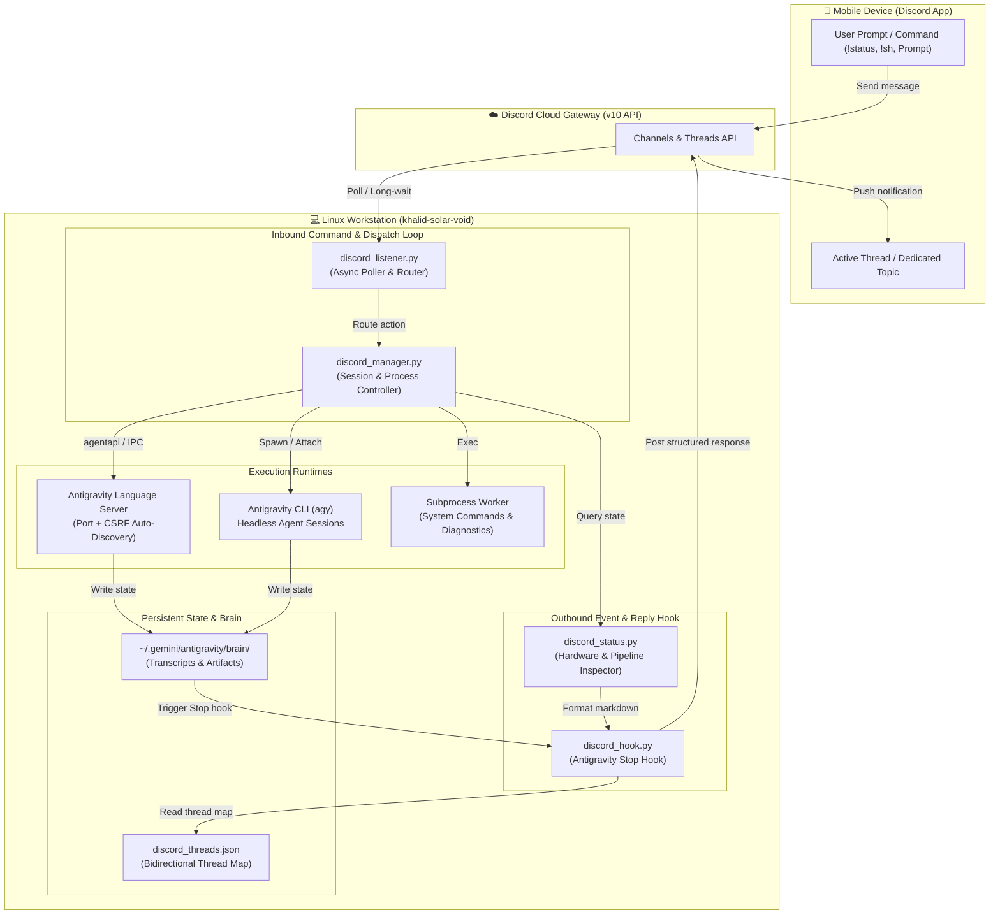
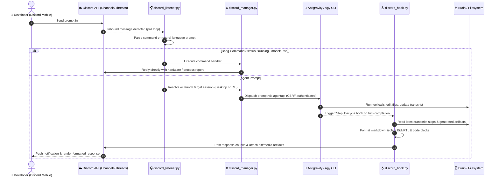

# Workstation Discord Bridge

<div align="center">

**Two-Way Autonomous Agent Steering, Mobile Supervison & Remote Linux Operations**

[](https://python.org)
[](https://kernel.org)
[](https://discord.com)
[](https://github.com/google)
[](https://github.com/kmbenjel/workstation-discord-bridge)

</div>

---

## 📌 Executive Summary

**Workstation Discord Bridge** is a production-grade, bi-directional operations bridge connecting an active Linux development workstation to Discord. It enables full, low-latency mobile supervision and steering over autonomous AI developer sessions (Google Antigravity Desktop & CLI, Claude Desktop & Claude Code), long-running background tasks, system resources, and shell operations directly from a mobile smartphone without needing a clunky remote desktop client.

Whether commuting, away from the desk, or monitoring overnight builds, you can **launch and run Antigravity and Claude Desktop sessions**, **activate remote control on Claude** to seamlessly hand off and continue development on mobile, manage background processes, and inspect live hardware telemetry — all directly using Discord messages.

---

## 🏗️ Architecture & Data Flow

The bridge decouples **inbound mobile commands** (polled via high-frequency resilient listener) from **outbound agent responses** (triggered deterministically via lifecycle hooks), ensuring zero blocking on the agent runtime and instant event dispatching.



---

## 🔄 Sequence Diagram: Interactive Agent Steering Lifecycle

The sequence below illustrates how an incoming prompt or command sent from Discord mobile is dispatched to an AI agent session on the workstation, executed, and synced back to the matching mobile Discord thread:



---

## ⚡ Core Capabilities & Technical Highlights

### 1. Antigravity & Claude Desktop Orchestration with Mobile Remote Control
- **Launch & Steer Desktop Sessions**: Trigger, steer, and interact with Google Antigravity Desktop IDE sessions and Claude Desktop runs directly through Discord chat messages.
- **Claude Remote Control Handoff**: Activate remote control mode on Claude via Discord commands, seamlessly handing off active desktop coding sessions to continue steering and reviewing on mobile without missing a beat.
- **Dynamic Port & Token Discovery**: `discord_manager.py` inspects active Linux process trees (`ps -ef`), extracts the dynamic language server port and CSRF authentication token from `/proc/<pid>/cmdline`, and automatically handles authentication without static passwords.
- **Headless Auto-Launch & CLI Fallback**: If the Desktop IDE is closed, the manager can auto-launch it in a headless display environment or gracefully divert the task to `/home/k/.local/bin/agy` CLI.
- **Bi-directional Symlink Mesh**: Automatically unifies conversation histories across Desktop (`~/.gemini/antigravity/brain`) and CLI (`~/.gemini/antigravity-cli/brain`), allowing you to inspect CLI runs from Desktop and vice versa.

### 2. Comprehensive Mobile Command Suite
From your phone's Discord client, send commands to control the machine:

| Command | Action & Output |
|---|---|
| `!status` | Full workstation telemetry: CPU load, RAM usage, swap, battery level, temperature, and disk space. |
| `!running` | Live list of active background workers, systemd services, and long-running scripts. |
| `!sessions` | List active, recent, and archived agent sessions across Desktop and CLI. |
| `!models` / `!quota` | Inspect available Gemini / Claude / local models and current rate limits / quotas. |
| `!stop` / `!cancel` | Terminate stuck subagents, background builds, or endless tool loops immediately. |
| `!fork` | Fork an existing conversation into an isolated branch thread for exploratory debugging. |
| `!sh <command>` | Execute raw Linux shell commands with output returned directly to Discord. |
| `!cli <prompt>` | Launch a dedicated headless CLI agent turn and stream output to a new thread. |

### 3. Arabic & Bidirectional Text Perfection (Bidi / RTL)
- Built-in heuristics format Arabic prose with proper Unicode directionality containers (`<div dir="rtl">`).
- English technical terms, version strings, numbers, and file paths are isolated with `<bdi dir="ltr">` so punctuation never reverses.
- Terminal outputs, code snippets, and JSON blocks are locked to strict `dir="ltr"` and left alignment.

### 4. Zero-Leak Secret Isolation
- Sensitive credentials (`bot_token`, `guild_id`, `channel_id`, `user_id`) are stored in `discord_config.json` with `chmod 600` permissions and never tracked by Git.
- Multi-process lockfiles (`fcntl.flock`) prevent race conditions between simultaneous hook executions and listener cycles.

---

## 📂 Repository Structure

```
workstation-discord-bridge/
├── discord_manager.py          # Session controller, agentapi client, and process manager
├── discord_listener.py         # Polling loop for Discord messages, threads, and bang commands
├── discord_hook.py             # Antigravity Stop hook: formats & transmits responses to Discord
├── discord_status.py           # Hardware, systemd, and pipeline telemetry collector
├── discord_send.py             # Standalone CLI utility to send messages to Discord
├── hooks.json.example          # Sample Antigravity hooks configuration
├── discord_config.example.json # Safe configuration schema template
├── requirements.txt            # Python dependencies
├── systemd/
│   └── discord-listener.service# Systemd service unit for 24/7 background operation
└── README.md                   # This documentation
```

---

## 🚀 Setup & Installation

### 1. Prerequisites
- Linux OS (tested on Ubuntu / Debian / Fedora)
- Python 3.10+
- A Discord Bot with Message Content Intent enabled ([Discord Developer Portal](https://discord.com/developers))

### 2. Configuration
Clone the repository and prepare your private config:
```bash
git clone https://github.com/kmbenjel/workstation-discord-bridge.git
cd workstation-discord-bridge

# Copy the example config
cp discord_config.example.json discord_config.json
chmod 600 discord_config.json
```

Edit `discord_config.json`:
```json
{
  "bot_token": "YOUR_DISCORD_BOT_TOKEN",
  "guild_id": "YOUR_SERVER_ID",
  "channel_id": "YOUR_MAIN_CHANNEL_ID",
  "user_id": "YOUR_DISCORD_USER_ID"
}
```

### 3. Antigravity Hook Integration
Add the hook to your Antigravity hooks file (`~/.gemini/config/hooks.json` or project hooks):
```json
{
  "discord-reply-sync": {
    "enabled": true,
    "Stop": [
      {
        "type": "command",
        "command": "/usr/bin/python3 /path/to/workstation-discord-bridge/discord_hook.py",
        "timeout": 15
      }
    ]
  }
}
```

### 4. Running as a Background Systemd Service
To keep the listener running continuously:
```bash
# Copy and enable the service
mkdir -p ~/.config/systemd/user
cp systemd/discord-listener.service ~/.config/systemd/user/
systemctl --user daemon-reload
systemctl --user enable --now discord-listener.service

# Check live logs
journalctl --user -u discord-listener.service -f
```

---

## 📸 Mobile Supervision & Live Agent Steering Showcase

> [!NOTE]
> Below are placeholder cards for visual captures, mobile screenshots, and live screen-cast demos illustrating real-world steering of the Linux workstation from iOS / Android.

<div align="center">

| 📱 Mobile Agent Steering & Desktop Sessions | ⚡ Live Telemetry & Process Check |
|:---:|:---:|
|  <br> *Run Antigravity & Claude Desktop sessions, activate Claude remote control, and review code diffs directly from mobile Discord* |  <br> *`!status` hardware & active background pipeline metrics* |

</div>

<br>

<div align="center">

| 🛑 Emergency Process Cancellation | 💻 Raw Shell Execution (`!sh`) |
|:---:|:---:|
|  <br> *Instant termination of stuck subagents via `!stop`* |  <br> *Safe single-line bash execution directly from mobile* |

</div>

---

## 📄 License

MIT License. Designed and engineered by [Khalid Benjelloun](https://benjelloun.dev).
