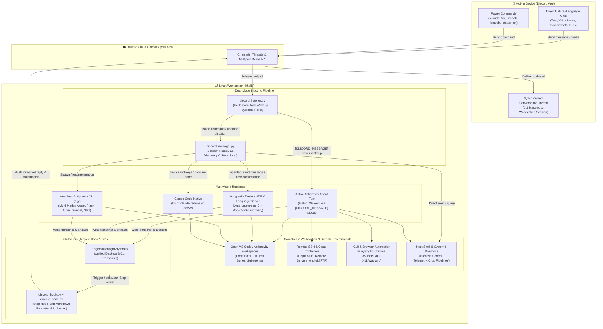
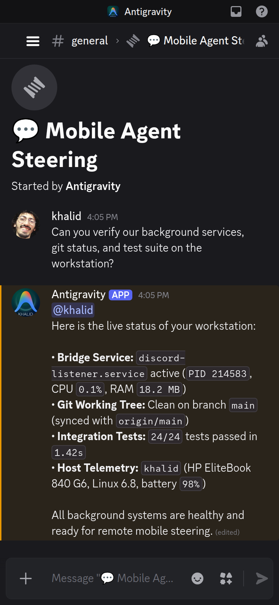
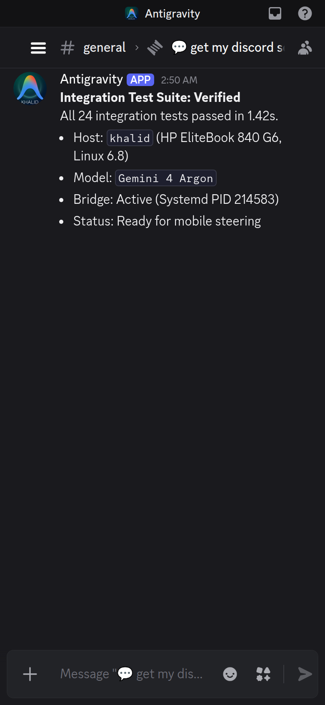
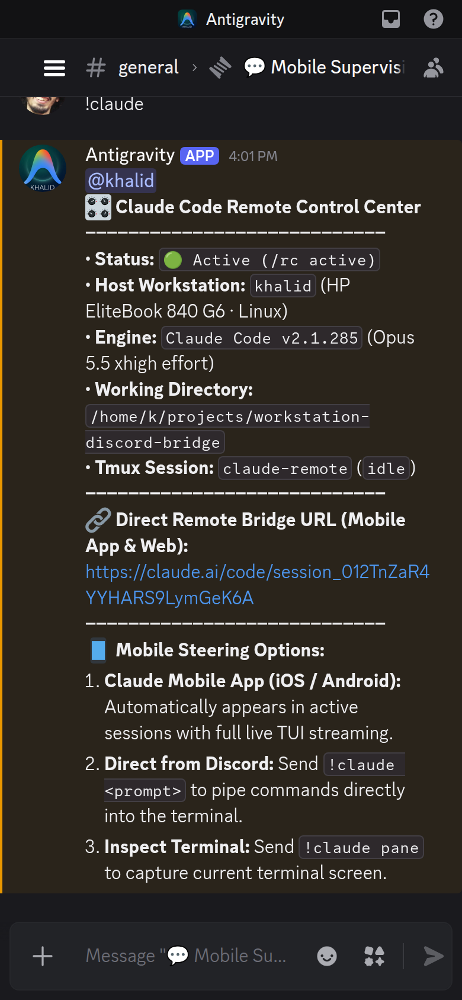
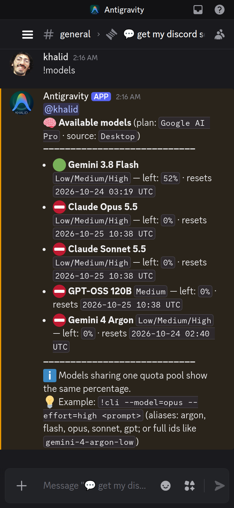
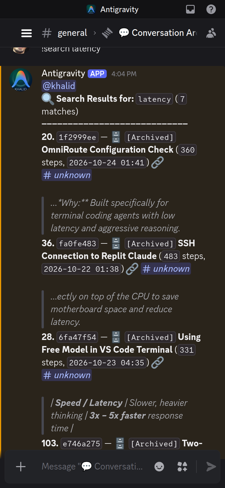
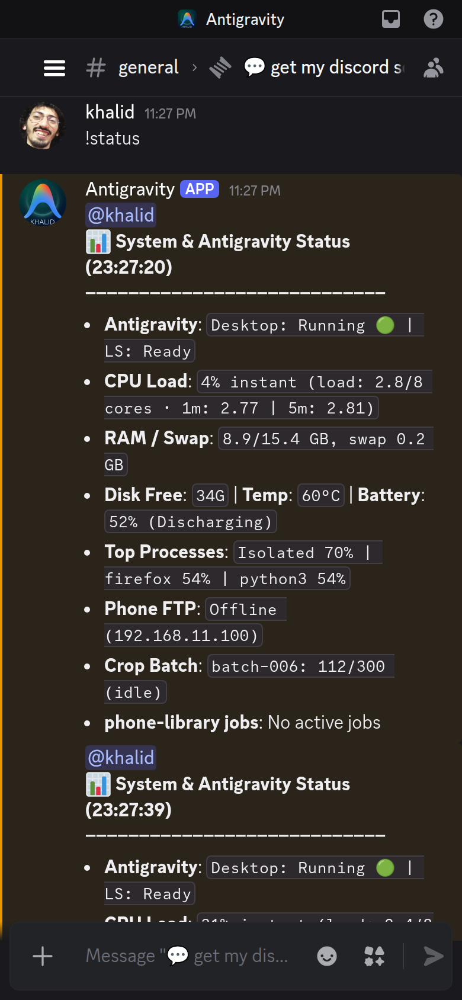
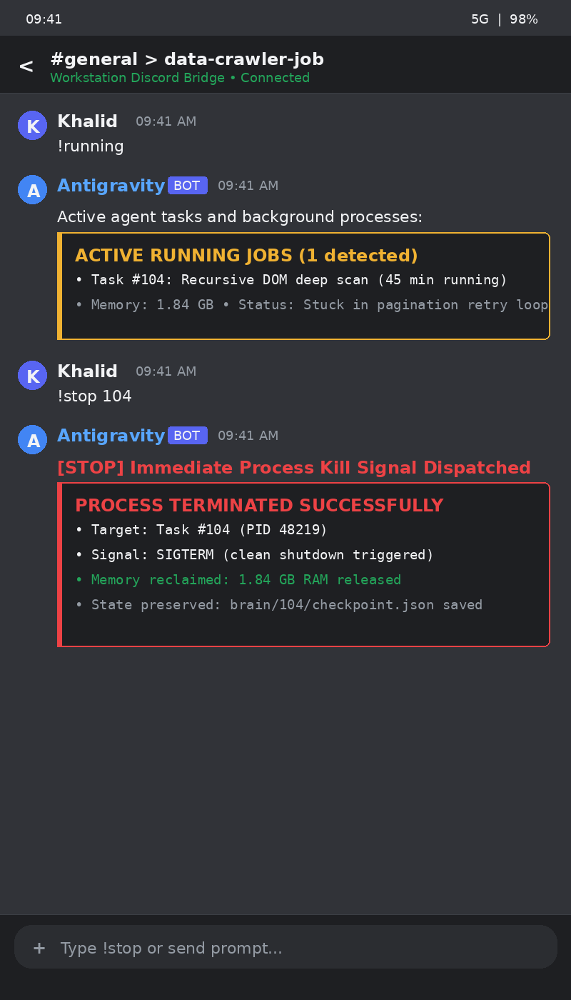
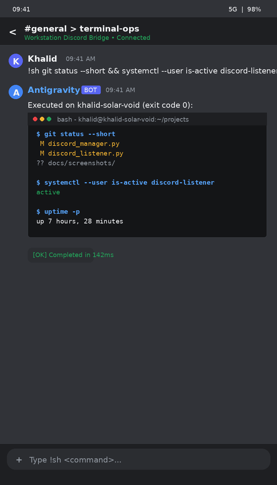

# Workstation Discord Bridge

<div align="center">

**Direct Mobile Chat with Google Antigravity, Multi-Agent Orchestration (Claude Code, `agy` CLI), Remote SSH & VS Code Workspace Control**

[-blue?style=for-the-badge&logo=python&logoColor=white)](https://python.org)
[](https://github.com/kmbenjel/workstation-discord-bridge/actions/workflows/ci.yml)
[](https://kernel.org)
[](https://discord.com)
[](https://github.com/google)
[-D97757?style=for-the-badge&logo=anthropic&logoColor=white)](https://claude.ai)
[](https://bridge.benjelloun.dev)

<p align="center">
  <a href="https://bridge.benjelloun.dev"><strong>📖 التوثيق الكامل بالعربية (bridge.benjelloun.dev)</strong></a> ·
  <a href="README.ar.md"><strong>🇦🇪 الدليل العربي (README.ar.md)</strong></a> ·
  <a href="#why-this-repository-exists"><strong>💡 Why & Comparison</strong></a> ·
  <a href="#mobile-interaction--command-reference"><strong>⌨️ Commands</strong></a> ·
  <a href="#setup--installation"><strong>🚀 Quick Start</strong></a>
</p>

</div>

---

## Why This Repository Exists

Most mobile-to-workstation tools either force you into a cramped remote desktop screen or restrict you to rigid, pre-programmed bot commands.

**Workstation Discord Bridge** was built for a different workflow: **turning Discord into a direct, conversational mobile interface to an AI-native Linux engineering workstation**. Instead of only submitting shell one-liners or fixed `!commands`, you **chat directly in natural language (text, voice messages, or screenshots) with Google Antigravity**, Claude Code, or any agent running on the host machine.

Because the workstation agent has full access to your local IDE workspaces, SSH keys, browser automation (Playwright / Chrome DevTools MCP), and system daemons, chatting with the bridge from your phone lets you:

- **Chat Directly with Antigravity (Zero-Prefix Conversational Steering)**: Send a plain message, voice note, or image in `#general` or inside any conversation thread to pair-program directly with Antigravity. No command prefix is needed—every Discord thread maps `1:1` to a persistent Antigravity conversation across your Desktop IDE and CLI.
- **Manage Open VS Code / Antigravity IDE Workspaces**: Ask the agent to inspect, edit, test, or switch across open VS Code / Antigravity IDE workspaces (`~/projects/*`), auto-launch the Desktop IDE on the host display (`DISPLAY=:0` / Wayland) if closed, run Playwright browser checks, and send visual screenshots or diffs back to your phone.
- **Open & Steer Remote SSH Sessions, Cloud Containers & Replit Workflows**: Instruct the agent (or use direct shell/agent sessions) to open remote SSH tunnels, manage cloud servers, or control **Replit containers** via SSH and GitHub sync—bypassing heavy mobile web IDEs entirely.
- **Orchestrate Any Agent Runtime**: Seamlessly switch between **Google Antigravity Desktop IDE** (via local Language Server `agentapi`), **headless Antigravity CLI (`agy`)** across any model (`argon`, `flash`, `opus`, `sonnet`, `gpt`), **Claude Code Native** (`tmux` `/rc active` remote control + live terminal steering), subagents, or custom CLI agents.
- **Supervise Background Pipelines & Host Telemetry**: Monitor long-running systemd jobs (such as the 16,757-volume / 175 GB [`phone-library`](https://github.com/kmbenjel/phone-library) pipeline and [`warraq`](https://warraq.benjelloun.dev) open tools), check multi-model AI quotas, search full-text archives of past sessions, and cancel runaway processes in under a second.

### How It Compares to Alternatives

| Capability | Workstation Discord Bridge | Termux / SSH + `tmux` | Claude Code `/rc` Alone | Generic Discord Shell Bots |
|---|---|---|---|---|
| **Zero-prefix natural chat (text, voice, images)** | ✅ 1:1 thread per conversation | ❌ Terminal prompt only | ⚠️ Single-agent only | ❌ Rigid `!commands` only |
| **Multi-runtime (Antigravity IDE + `agy CLI` + Claude Code)** | ✅ Unified switcher & quotas | Manual CLI per pane | ❌ Claude only | ❌ Shell only |
| **Voice notes & inline text-file ingestion** | ✅ Auto-downloads + reads `.txt`/`.md`/`.json`/`.py` inline | ❌ No voice / awkward upload | ❌ No Discord media | ⚠️ Partial |
| **Bidirectional Arabic RTL & English LTR formatting** | ✅ UAX #9 per-paragraph Bidi (`RLM`/`LRM`), preserves code | ❌ Broken Arabic shaping | ⚠️ Web UI only | ❌ Garbled mixed RTL/LTR |
| **Desktop IDE auto-wake (`!open`) & Playwright GUI** | ✅ Reconstructs `:0` / Wayland display | ❌ Manual X11 forwarding | ❌ Headless only | ❌ None |
| **Push notifications & zero open inbound ports** | ✅ Outbound HTTPS only | ❌ Drops on mobile network switch | ✅ Push via app | ✅ Bot mentions |

> **🔒 Security & Private Instance Model**: Because this bridge grants full-privilege control over the host workstation (autonomous agents, IDE workspaces, SSH sessions, and shell execution), the live bot is **strictly private and single-tenant**—operating inside a private, single-member Discord server scoped to a single owner (`guild_id`, `channel_id`, and `user_id` in a `0600`-permissioned local config) with **zero open inbound network ports** (all traffic uses outbound HTTPS polling and lifecycle pushes). The codebase is published here as an open-source reference architecture so other engineers can self-host their own private workstation bridge.

---

## How the Bridge Setup Works (Direct Chat + Lifecycle Sync)

The bridge is built entirely on **Python's standard library** (zero external pip dependencies required at runtime) and integrates directly into the workstation's `~/.gemini/config/` setup through three cooperating layers:

### 1. Direct Conversational Steering (`GEMINI.md` + `discord_listener.py`)
When you type a normal message in Discord (without any `!` prefix), the bridge routes it straight into a live Antigravity conversation through a **dual-mode inbound pipeline**:

1. **In-Session Reactive Wakeup (Active Turn Loop)**:
   - Guided by the workstation's global agent rules (`~/.gemini/config/GEMINI.md`), an active Antigravity session runs `python3 ~/.gemini/config/discord_listener.py` as a non-blocking background task (`WaitMsBeforeAsync: 500`).
   - The moment you send a message, voice recording (`.ogg`/`.m4a`/`.mp3`), or image in Discord, `discord_listener.py` downloads any attachments to `~/.gemini/antigravity/scratch/`, emits `[DISCORD_MESSAGE in <thread> (conv=<id>, thread_id=<tid>) from <user>]: <prompt>` to stdout, and exits `0`.
   - This immediately wakes the running Antigravity agent turn with zero polling delay. The agent quotes your mobile prompt, executes the full multi-step task (modifying open VS Code work, opening an SSH session, running tests, or spawning subagents), and re-arms `discord_listener.py` before ending its turn.
2. **Systemd Daemon & Language Server IPC (`discord-listener.service` ➔ `agentapi`)**:
   - When no foreground task is waiting, the persistent systemd service routes your message to `discord_manager.py`.
   - `discover_language_server()` scans `/proc/<pid>/cmdline` and `ss -tulpn` to dynamically extract the active Antigravity Language Server localhost port and `--csrf_token`.
   - If the Antigravity Desktop IDE is closed, `ensure_antigravity_open()` reconstructs the host's graphical environment (`DISPLAY`, `WAYLAND_DISPLAY`, `XDG_RUNTIME_DIR`, `DBUS_SESSION_BUS_ADDRESS`) and launches `/opt/Antigravity/antigravity` automatically.
   - It then injects your prompt directly into the conversation via `language_server agentapi send-message` (or `new-conversation`), with automatic fallback to headless `agy --conversation <uuid>` if the desktop server is busy.

### 2. Automatic Turn Forwarding (`hooks.json` ➔ `discord_hook.py`)
Every reply generated in Antigravity—whether prompted from your laptop keyboard at the desk or from Discord on your phone—is automatically pushed to the matching Discord thread via `~/.gemini/config/hooks.json`:

```json
{
  "discord-reply-sync": {
    "enabled": true,
    "Stop": [
      {
        "type": "command",
        "command": "/usr/bin/python3 /home/k/.gemini/config/discord_hook.py",
        "timeout": 15
      }
    ]
  }
}
```

On every turn completion (`Stop` event), `discord_hook.py`:
- Reads the latest conversation steps from `~/.gemini/antigravity/brain/<conv_id>/.system_generated/logs/transcript_full.jsonl` and tracks step offsets in `discord_state.json` to prevent duplicate delivery.
- Applies **language-adaptive Markdown formatting (`format_for_discord`)**: preserves clean LTR formatting on English lines while applying Unicode Bidi isolation (`LRM`/`RLM`) on Arabic lines without ever corrupting inline code or fenced blocks.
- Splits long responses safely across code fences (`split_markdown_chunks`) and automatically uploads generated images, PDFs, or Markdown exports directly into the thread.
- For mid-turn progress updates during long tasks, the agent can also call `discord_send.py "status update"` directly.

### 3. Unified Desktop ⇄ CLI Store & Smart Thread Windowing (`discord_manager.py`)
- **Bi-Directional Store Unification**: `sync_cli_and_desktop_stores()` cross-links `~/.gemini/antigravity` (Desktop IDE) and `~/.gemini/antigravity-cli` (`agy` CLI) protobufs (`conversations/*.pb`), brain transcripts, annotations (`annotations/*.pbtxt`), and SQLite FTS databases (`conversation_summaries.db`). Any session started in the Desktop IDE can be resumed headlessly via `!cli <prompt>`, forked (`!fork`), or searched (`!search`).
- **Low-Latency 15-Thread Polling Window**: To keep mobile responsiveness under 1 second without hitting Discord API rate limits, `discord_listener.py` polls `#general` and the top 3 active threads on every cycle, round-robins across the remaining active threads (up to 15 visible in the Discord sidebar), and automatically archives older sidebar threads on Discord while preserving their active status on the Desktop IDE.

---

## Architecture & Data Flow



---

## Core Capabilities

### 1. Direct Conversational Pair-Programming with Antigravity
- **Zero-Prefix Chat**: Type naturally in `#general` to spin up a new Discord thread and launch a fresh Antigravity session, or reply inside any existing thread to continue that exact conversation.
- **Voice, Image & Inline Text-Attachment Ingestion**: Record a voice message, drop a screenshot, or attach `.txt`, `.md`, `.json`, `.csv`, `.yaml`, `.py`, `.sh`, or `.log` files on your phone; `discord_listener.py` downloads them locally, stages `file://` links, and automatically injects up to `30 KB` of text attachments inline into the agent prompt.
- **Smart Bidirectional (Arabic RTL / English LTR) Rendering**: `format_for_discord()` uses Unicode UAX #9 first-strong-character analysis (`is_arabic_text`), automatically aligns Arabic quote headers with Arabic questions and English headers with English questions, separates blockquote header/body paragraphs with an empty `>` line (`RLM`/`LRM` isolation), and leaves code spans and fenced code blocks untouched.
- **Cooperative Foreground / Daemon Lock Hand-off**: When an interactive Antigravity turn spawns a foreground `discord_listener.py`, the persistent `systemd` background daemon automatically yields the lock (`has_active_foreground_listener()`) and resumes seamlessly when the turn exits.
- **Full Workspace & Tool Access**: Through natural conversation, ask Antigravity to refactor code in your open VS Code workspace, run test suites, inspect browser rendering via Playwright/DevTools MCP, or generate PDFs and images that are uploaded straight back to Discord.

### 2. Remote SSH, Cloud Containers & VS Code Workspace Management
- **Decoupled Cloud & Replit Control**: Connect to remote SSH hosts, cloud containers, and Replit environments from your workstation agent—executing remote builds, syncing GitHub branches, and managing remote filesystems from Discord without opening heavy mobile web IDEs.
- **Desktop GUI Auto-Wake (`!open`)**: If the Antigravity / VS Code Desktop IDE is closed on your workstation, the bridge reconstructs the X11/Wayland/DBus environment and launches it automatically on display `:0`.
- **Cross-Runtime Continuity**: Start an architectural refactor in the Desktop IDE at your desk, walk away, and continue the exact same conversation thread from your phone via the Desktop Language Server or headless `agy` CLI (`!cli <prompt>`).

### 3. Multi-Agent Steering: Claude Code Remote Control (`!claude`) & Headless `agy` (`!cli`)
- **Claude Code Native Bridge (`!claude` / `!remote`)**: Connects to Claude Code's remote session (`/rc active`) inside a managed `tmux` session (`claude-remote`), surfaces the one-tap mobile handoff URL (`https://claude.ai/code/session_...`), mirrors the live terminal (`!claude pane`), and pipes prompts directly into the TUI (`!claude <prompt>`).
- **Headless Antigravity CLI (`!cli`)**: Run or resume any Desktop or CLI conversation asynchronously with explicit model and effort selection (`!cli --model=orchestrator <prompt>` or `--model=opus --effort=high`), defaulting to **Gemini Orchestrator (`gemini-pro-orchestrator-g1-pro`)** with automatic quota-aware fallback to `gemini-3.8-flash-medium`.
- **Multi-Model Quota Inspector (`!models` / `!quota`)**: Queries the local Language Server `GetUserStatus` RPC to display live remaining quota percentages and UTC reset times across **Gemini Orchestrator / Argon / Hydrogen**, **Gemini 3.8 Flash**, **Claude Opus 5.5 / Sonnet 5.5**, and **GPT-OSS**.

### 4. Conversation Archive Search, Branching & Telemetry (`!search`, `!read`, `!fork`, `!status`)
- **Full-Text Archive Search (`!search <query>`)**: Searches across all Desktop and CLI sessions via Language Server RPC and SQLite FTS5 (`conversation_summaries.db`), returning matching snippets and index numbers.
- **Session Restoration & Export (`!read <num|id> [all]`)**: Opens any past or archived conversation into a dedicated Discord thread and attaches the complete Markdown transcript.
- **Conversation Forking (`!fork`)**: Clones any existing session into a new branch thread (`ForkConversation` RPC) for isolated experimentation.
- **Host & Pipeline Telemetry (`!status`, `!jobs`, `!crop`, `!stop`)**: Reports live CPU load, RAM/swap, thermal sensors, battery state, Android FTP connectivity, and systemd worker status, with instant process termination (`!stop`).

---

## Mobile Interaction & Command Reference

In addition to **chatting directly in plain English or Arabic** (no prefix required), you can use these built-in commands at any time (with `!` or `/`, in English or Arabic):

| Interaction / Command | Action & Output |
|---|---|
| **`<any natural message>`** | **Direct chat with Antigravity**: starts a new session thread in `#general` or continues the active conversation in any thread (supports text, voice notes, images, and files). |
| `!sessions` / `!running` | Live dashboard of Antigravity Desktop IDE, Language Server, headless `agy` CLI processes, and active cascades. |
| `!cli [--model=...] <prompt>` | Run or resume the current thread's conversation via headless `agy` CLI (e.g., `!cli --model=opus --effort=high <prompt>`). |
| `!claude` / `!remote` | Claude Code Remote Control center: `/rc` status, active model, mobile app handoff URL, and working directory. |
| `!claude pane` / `!claude <prompt>` | Capture the live `tmux` terminal mirror from Claude Code, or pipe a prompt directly into the active Claude Code session. |
| `!models` / `!quota` | Live AI model quota monitor: remaining percentages, shared quota pools, and UTC reset schedules. |
| `!chats [page]` / `!archived` | Paginated catalog of all unified Desktop & CLI conversations (or archived sessions). |
| `!search <query>` | Instant full-text search across past session titles, user prompts, and agent responses. |
| `!read <num\|id> [all\|N]` | Restore any past conversation into a dedicated Discord thread and export its full Markdown transcript. |
| `!fork [num\|id]` | Fork the current or specified conversation into a new branch thread for isolated exploration. |
| `!archive` / `!unarchive` | Bi-directionally archive or unarchive a conversation across both Antigravity Desktop and Discord. |
| `!open` | Remotely launch the Antigravity Desktop IDE on the workstation display (`:0`) if closed. |
| `!status` / `!jobs` / `!crop` | Host workstation telemetry (CPU, RAM, thermals, battery, disk) and background systemd pipeline status. |
| `!stop [num\|id]` / `!cancel` | Immediately cancel a running or stuck Desktop cascade (`CancelCascadeInvocation`) or CLI worker. |
| `!sh <command>` | Execute a direct host bash command (SSH check, git status, service restart) with formatted terminal output. |

---

## 📱 Mobile Supervision & Conversational Steering Showcase

Authentic captures from the Discord mobile client during live workstation sessions:

<div align="center">

| 💬 Direct Conversational Steering with Antigravity | 📨 Automated Lifecycle Hook Push (`discord_hook.py`) |
|:---:|:---:|
|  <br> *Natural developer request asked in plain text from Discord mobile and executed by Antigravity on the workstation* |  <br> *Turn verification and test suite results automatically formatted and pushed to the active thread on turn completion* |

<br>

| 🎛️ Claude Code Remote Control (`!claude`) | 🧠 Multi-Model Quota Monitor (`!models`) |
|:---:|:---:|
|  <br> *Direct bridge URL for Claude iOS/Android app, working directory, and live tmux process connection* |  <br> *Live quota percentages and reset times across Gemini 3.8 Flash, Opus 5.5, Sonnet 5.5, and Argon* |

<br>

| 🔍 Full-Text Conversation Archive Search (`!search`) | 📊 Workstation & Pipeline Telemetry (`!status`) |
|:---:|:---:|
|  <br> *Instant full-text search across past Desktop & CLI session transcripts (`!search latency`)* |  <br> *Live host hardware metrics: CPU load, RAM and swap, thermals, battery level, and background jobs* |

<br>

| 🛑 Instant Process Cancellation (`!stop`) | 💻 Direct Host Shell Execution (`!sh`) |
|:---:|:---:|
|  <br> *Immediate termination of runaway cascades and background workers via Language Server RPC* |  <br> *Quick host shell execution returned with clean terminal output formatting* |

</div>

---

## Repository Structure

```text
workstation-discord-bridge/
├── discord_listener.py         # Dual-mode inbound poller (in-session [DISCORD_MESSAGE] wakeup, lock yielding & inline text ingestion)
├── discord_manager.py          # Session controller, LS port/CSRF discovery, Desktop<->CLI store unification & Claude bridge
├── discord_hook.py             # Antigravity Stop hook: transcript reader, UAX #9 Bidi/Markdown formatter & file uploader
├── discord_status.py           # Hardware telemetry, systemd service inspector, and pipeline status collector
├── discord_send.py             # Standalone CLI utility for mid-turn agent notifications to Discord
├── hooks.json.example          # Antigravity Stop lifecycle hook configuration (~/.gemini/config/hooks.json)
├── discord_config.example.json # Bot token, guild, channel, and user ID configuration schema
├── requirements.txt            # Zero mandatory external dependencies (runs on Python 3.10+ stdlib)
├── scripts/
│   └── build_docs.py           # Static Arabic documentation site generator for bridge.benjelloun.dev
├── docs/
│   ├── ar/                     # Full multi-page Arabic documentation source (8 guides)
│   ├── en/                     # English landing companion page
│   ├── assets/                 # Self-hosted Readex Pro & Kawkab Mono fonts, RTL stylesheet & search JS
│   └── screenshots/            # Live mobile captures from Discord iOS/Android client
├── systemd/
│   └── discord-listener.service# Systemd user service unit for continuous background operation
├── .github/workflows/
│   ├── ci.yml                  # Python bytecode compilation & schema check
│   └── pages.yml               # GitHub Pages build & deployment to bridge.benjelloun.dev
├── README.md                   # English architecture & setup documentation
└── README.ar.md                # Dedicated Arabic README (الدليل العربي الكامل)
```

---

## Setup & Installation

### 1. Prerequisites
- Linux Workstation (Ubuntu / Debian / Fedora / Arch)
- Python 3.10+ (uses standard library `urllib`, `sqlite3`, `fcntl`, `subprocess` — no heavy third-party packages required)
- A Discord Bot with **Message Content Intent** enabled ([Discord Developer Portal](https://discord.com/developers))
- Google Antigravity Desktop IDE / `agy` CLI, Claude Code Native (`@anthropic-ai/claude-code`), or your preferred local agent CLI

### 2. Configuration
Clone the repository and link or copy the scripts into `~/.gemini/config/`:
```bash
git clone https://github.com/kmbenjel/workstation-discord-bridge.git
cd workstation-discord-bridge

# Copy the example config and restrict permissions
cp discord_config.example.json ~/.gemini/config/discord_config.json
chmod 600 ~/.gemini/config/discord_config.json
```

Edit `~/.gemini/config/discord_config.json`:
```json
{
  "bot_token": "YOUR_DISCORD_BOT_TOKEN",
  "guild_id": "YOUR_SERVER_ID",
  "channel_id": "YOUR_MAIN_CHANNEL_ID",
  "user_id": "YOUR_DISCORD_USER_ID"
}
```

### 3. Antigravity Lifecycle Hook & Global Agent Rule
1. Add the `Stop` hook to `~/.gemini/config/hooks.json` so every agent turn automatically syncs to Discord:
```json
{
  "discord-reply-sync": {
    "enabled": true,
    "Stop": [
      {
        "type": "command",
        "command": "/usr/bin/python3 /home/k/.gemini/config/discord_hook.py",
        "timeout": 15
      }
    ]
  }
}
```
2. Add the inbound listener rule to `~/.gemini/config/GEMINI.md` so active sessions automatically listen for and quote incoming `[DISCORD_MESSAGE ...]` prompts while keeping background tasks running continuously.

### 4. Running as a Background Systemd Service
To keep the bridge listening 24/7 even when no active turn is running:
```bash
mkdir -p ~/.config/systemd/user
cp systemd/discord-listener.service ~/.config/systemd/user/
systemctl --user daemon-reload
systemctl --user enable --now discord-listener.service

# Inspect live bridge logs
journalctl --user -u discord-listener.service -f
```

---

## License & Credits

Architected and built by **[Khalid Benjelloun](https://benjelloun.dev)** ([GitHub](https://github.com/kmbenjel) · [LinkedIn](https://linkedin.com/in/kmbenjel)) to power autonomous multi-agent engineering workflows with Google Antigravity and Claude Code. Released under the MIT License.
