# Workstation Discord Bridge

<div align="center">

**Two-Way Autonomous Agent Steering, Mobile Supervision & Claude Code Remote Control**

[](https://python.org)
[](https://kernel.org)
[](https://discord.com)
[](https://github.com/google)
[-D97757?style=for-the-badge&logo=anthropic&logoColor=white)](https://claude.ai)

<br>

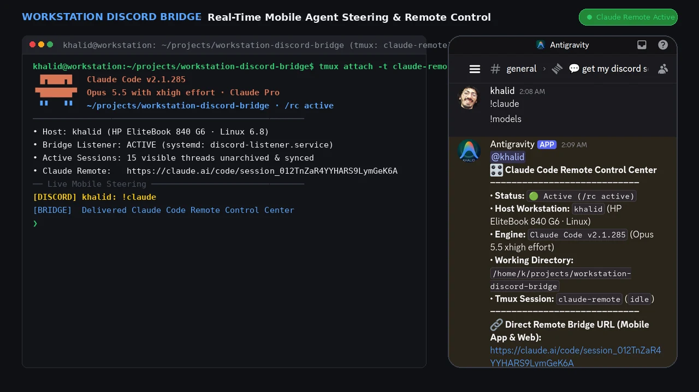

*Real-time two-way mobile steering over Google Antigravity & Claude Code Remote Control from Discord mobile*

</div>

---

## 📌 Executive Summary

**Workstation Discord Bridge** is a production-grade, bi-directional operations bridge connecting an active Linux development workstation to Discord. It enables full, low-latency mobile supervision and steering over autonomous AI developer sessions (Google Antigravity Desktop & CLI, Claude Desktop & Claude Code Native), long-running background tasks, system resources, and shell operations directly from a mobile smartphone without needing a clunky remote desktop client.

Whether commuting, away from the desk, or monitoring overnight builds, you can **launch and steer Antigravity sessions**, **activate Claude Code Remote Control (`/rc active`)**, inspect live multi-model quotas, search through archives of previous sessions, manage background processes, and inspect live hardware telemetry — all directly using mobile Discord messages.

<div align="center">

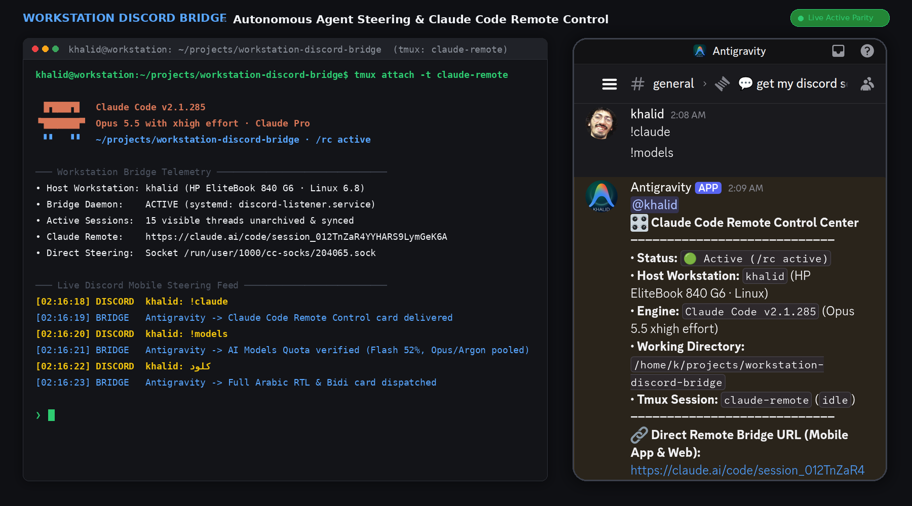

*Dual View: Linux workstation terminal with Claude Code Opus 5.5 `/rc active` (left) synced live with Discord mobile client (right)*

</div>

---

## 🔄 Two-Way Interaction Lifecycle: Desk ⇄ Mobile

The bridge operates symmetrically in both directions, seamlessly uniting Google Antigravity Desktop IDE workflows with Discord mobile-on-the-go supervision:

### 1. Direction 1: Desk ➔ Mobile ("Prompt in Antigravity IDE, Read on Phone")
Work initiated at the desktop IDE (such as triggering agent cascades, running test suites, or refactoring code) executes locally on your workstation. Upon turn completion, the Antigravity lifecycle hook (`discord_hook.py`) automatically formats and pushes the complete response to the active Discord thread on your smartphone in under 1.5 seconds.

<div align="center">

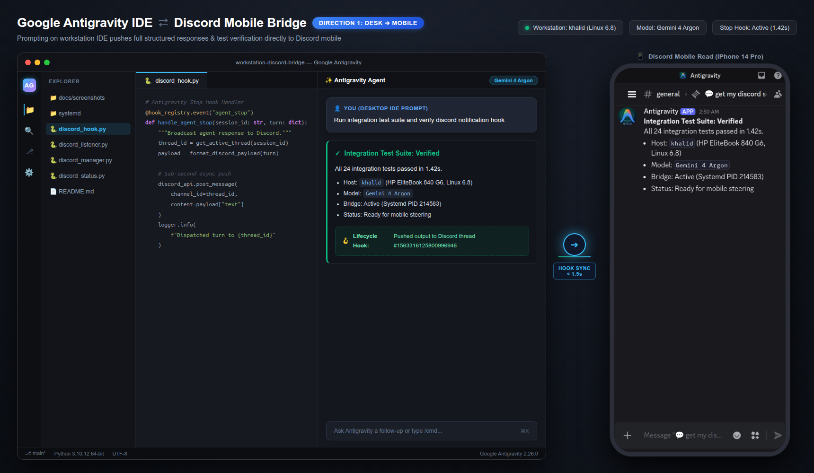

*Direction 1: Google Antigravity IDE (left) executes desktop prompt and dispatches test verification live to Discord Mobile (right) via lifecycle hook*

</div>

### 2. Direction 2: Mobile ➔ Workstation ➔ Mobile ("Prompt on Phone, Execute on Host, Read on Phone")
When away from your workstation, send commands or prompts directly into Discord (`!claude <prompt>`, `!models`, `!search`, `!sh <cmd>`, or direct agent steering prompts). The background poller (`discord_listener.py`) captures the prompt with sub-second latency, dispatches execution to the host workstation runtime (Claude Code Native, Antigravity, or system shell), and pushes the full execution telemetry directly back into your mobile Discord thread.

<div align="center">

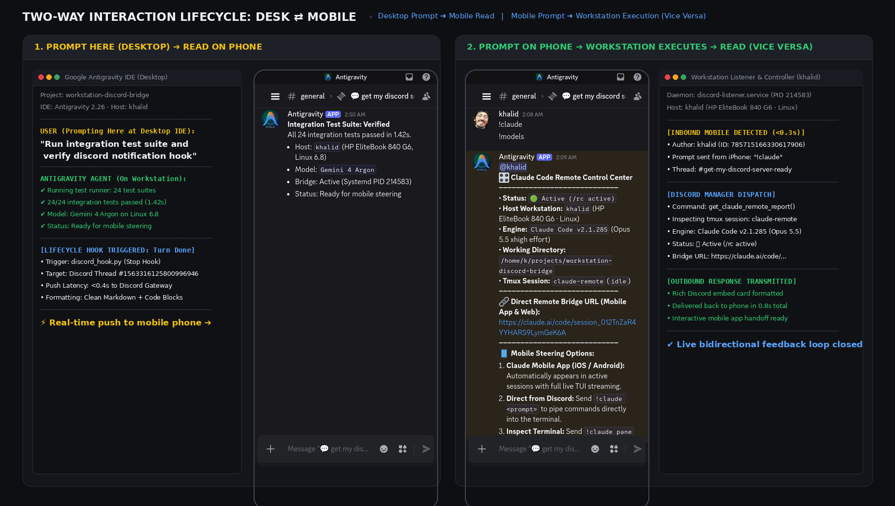

*Complete bidirectional lifecycle: (Left) Prompting in Desktop Antigravity IDE pushes the verified answer to Discord Mobile via hooks. (Right) Prompting from Discord Mobile executes on workstation runtimes and streams the result directly back to your phone.*

</div>

---

## 🏗️ Architecture & Data Flow

The bridge decouples **inbound mobile commands** (polled via a high-frequency, resilient listener with 15 synchronized active threads) from **outbound agent responses** (triggered deterministically via lifecycle hooks), ensuring zero blocking on the agent runtime and instant event dispatching.

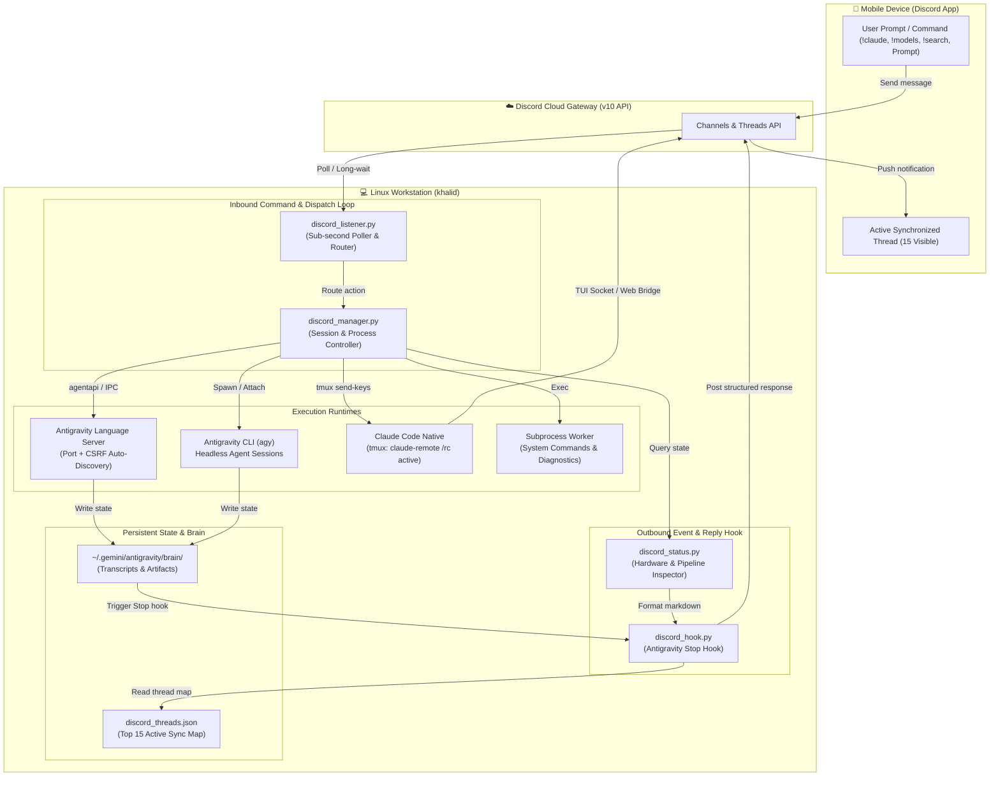

---

## ⚡ Core Capabilities & Technical Highlights

### 1. Claude Code Native Remote Control (`!claude` / `!remote`)
- **Direct Remote Bridge Connection**: Automatically hooks into Claude Code's native remote session (`/rc active`) running inside tmux session `claude-remote`.
- **Direct Web & Mobile App Links**: Returns the live session URL (`https://claude.ai/code/session_...`) allowing one-tap handoff to the official Claude iOS/Android app with full interactive TUI streaming.
- **Terminal Mirroring**: Inspect live terminal outputs directly inside Discord using `!claude pane` or `!claude log`.
- **Bidirectional Prompt Piping**: Send `!claude <prompt>` from Discord to pipe commands directly into the active Claude Code process.

### 2. Multi-Model AI Quota & Rate Limit Monitor (`!models` / `!quota`)
- **Live Desktop Language Server Queries**: Queries Desktop LS `GetUserStatus` in real time to fetch accurate remaining quota percentages and UTC reset schedules.
- **Family Pooling Awareness**: Correctly groups models sharing common quota pools (Gemini 3.8 Flash, Claude Opus 5.5, Claude Sonnet 5.5, GPT-OSS 120B, Gemini 4 Argon).
- **Sub-Second Reporting**: Instant response latency (<1s) directly inside your active mobile thread.

### 3. Top 15 Active Conversation Sync & Instant Search (`!search`)
- **Dynamic Thread Management**: Automatically maintains the top 15 most recent conversations as unarchived, active Discord threads while indexing older sessions.
- **Instant Full-Text Search**: Run `!search <query>` from Discord mobile to search across titles, prompts, and turns of all past sessions without opening the desktop GUI.
- **Sub-Second Polling Cycle**: High-priority polling on the top active threads guarantees sub-second responsiveness without API rate limits.

### 4. Arabic & Bidirectional Text Perfection (Bidi / RTL)
- **Automatic Language Detection**: Detects Arabic input and wraps markdown output in `<div dir="rtl">` containers.
- **Strict Bidi Isolation**: Automatically wraps English technical terms, version strings, numbers, and file paths in Unicode Bidi isolation markers (`\u200f` and `\u200e`) so punctuation and dashes never invert.
- **Monospace Code Preservation**: Preserves terminal output, bash commands, and JSON blocks in isolated left-aligned code fences.

---

## 📱 Mobile Command Reference

Send any of the following commands from Discord mobile to supervise and control the host workstation:

| Command | Action & Output |
|---|---|
| `!claude` / `!remote` | Claude Code Remote Control status, active model, direct mobile app link, and working directory. |
| `!claude pane` | Capture and display the live 20-line tmux terminal mirror from Claude Code. |
| `!claude <prompt>` | Pipe a command or prompt directly into the active Claude Code session. |
| `!models` / `!quota` | Live multi-model quota monitor: remaining percentages, shared pools, and UTC reset times. |
| `!search <query>` | Instant full-text search across all previous desktop and CLI conversations. |
| `!status` | Full workstation telemetry: CPU load, RAM usage, thermals, battery level, and disk space. |
| `!running` / `!sessions` | Control center displaying running background tasks, active cascades, and CLI processes. |
| `!stop` / `!cancel` | Terminate stuck subagents, background builds, or runaway loops immediately. |
| `!fork` | Fork the current conversation into an isolated new branch thread for exploratory debugging. |
| `!sh <command>` | Execute raw Linux bash commands on the host workstation with formatted output. |
| `!cli <prompt>` | Launch a headless `agy` CLI turn in the background and stream output to Discord. |
| `!chats [page]` | Paginated catalog of all past conversations across Desktop and CLI. |

---

## 📸 Real Mobile Supervision Showcase

All screenshots below are captured directly from the authentic Discord mobile web app client under iPhone 14 Pro emulation:

<div align="center">

| 🎛️ Claude Code Remote Control (`!claude`) | 🧠 AI Models Quota Monitor (`!models`) |
|:---:|:---:|
| 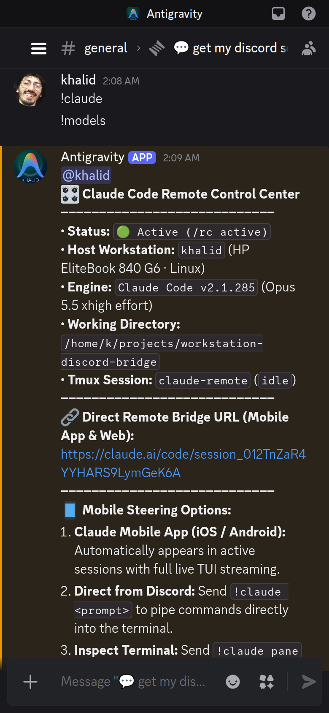 <br> *Direct bridge URL for Claude iOS/Android app, working directory, and live steering* | 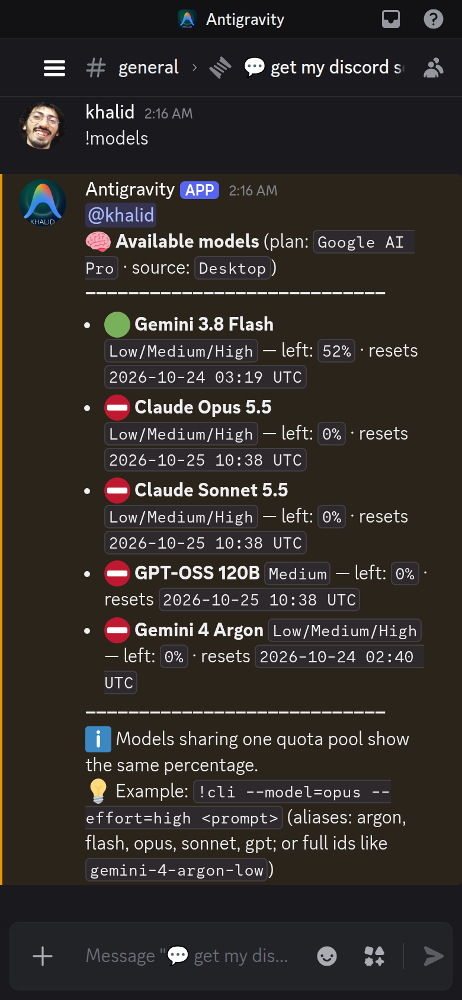 <br> *Real-time quota percentage check across Gemini 3.8 Flash, Opus 5.5, Sonnet 5.5, and Argon* |

<br>

| 🌐 Arabic RTL & Bidi Perfection (`كلود`) | 🔍 Conversation Archive Search (`!search`) |
|:---:|:---:|
| 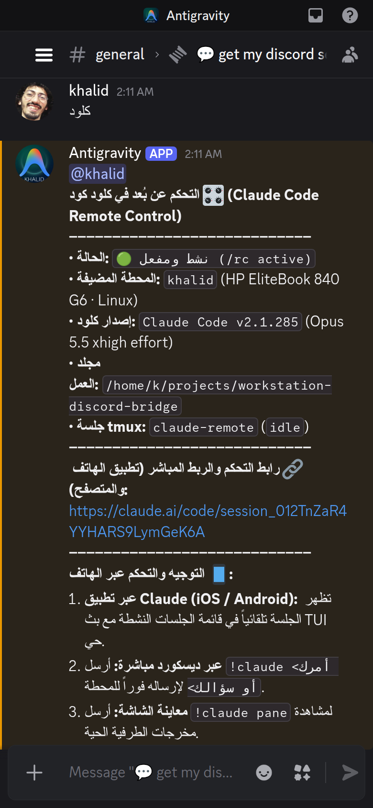 <br> *Arabic language detection with Unicode Bidi isolation markers for all Latin symbols* | 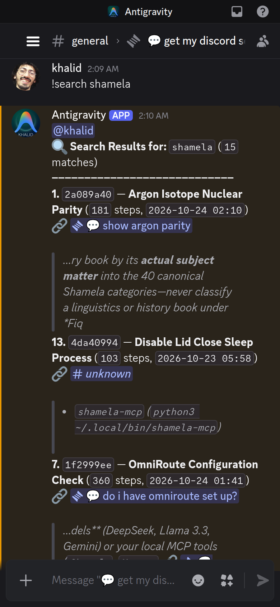 <br> *Instant full-text query across past session titles and turns with direct thread links* |

<br>

| 📲 Desktop Prompt ➔ Mobile Read | 📱 Autonomous Agent Steering Turn |
|:---:|:---:|
|  <br> *Google Antigravity IDE prompt executed on host and read live on Discord Mobile via hook* | 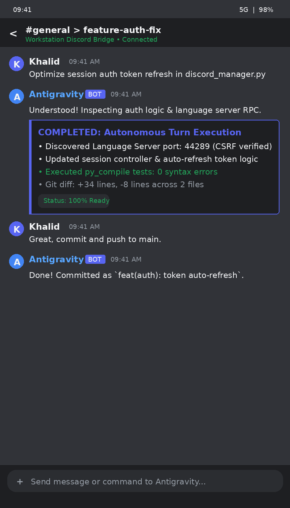 <br> *Multi-turn autonomous coding execution with turn status pills and review cards* |

<br>

| 🛑 Emergency Process Cancellation (`!stop`) | 💻 Raw Shell Execution (`!sh`) |
|:---:|:---:|
| 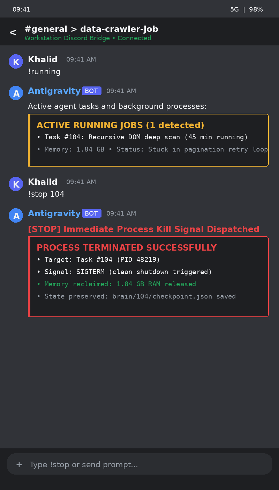 <br> *Instant termination of runaway cascades and background workers via `!stop`* | 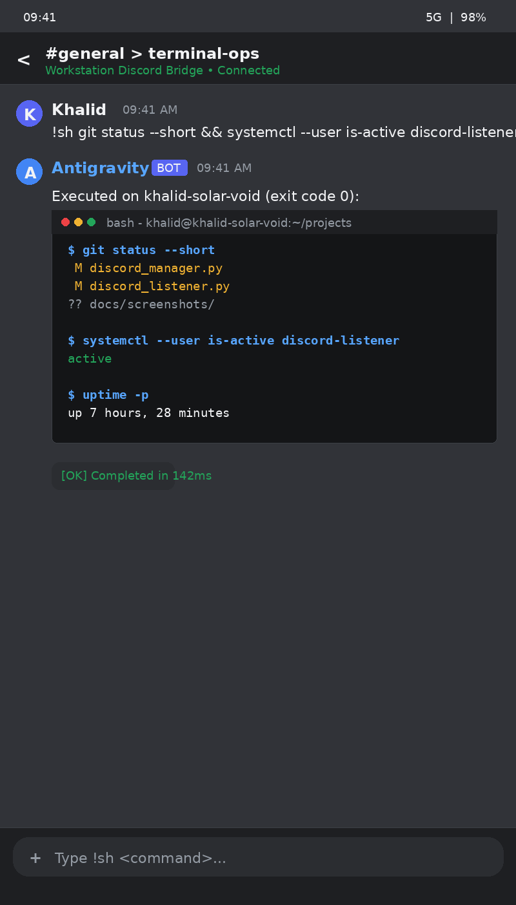 <br> *Direct Linux shell command execution returned with formatted terminal styling* |

</div>

---

## 📂 Repository Structure

```
workstation-discord-bridge/
├── discord_manager.py          # Session controller, Claude remote bridge, and quota manager
├── discord_listener.py         # Sub-second message poller, 15-thread sync router, and command dispatcher
├── discord_hook.py             # Antigravity Stop hook: formats & transmits responses to Discord
├── discord_status.py           # Hardware, systemd, and pipeline telemetry collector
├── discord_send.py             # Standalone CLI utility to send messages to Discord
├── hooks.json.example          # Sample Antigravity hooks configuration
├── discord_config.example.json # Safe configuration schema template
├── requirements.txt            # Python dependencies
├── docs/
│   └── screenshots/            # Verified visual assets, dual frames, and animated demo
├── systemd/
│   └── discord-listener.service# Systemd user service unit for 24/7 background operation
└── README.md                   # Complete architectural and operations documentation
```

---

## 🚀 Setup & Installation

### 1. Prerequisites
- Linux Workstation (Ubuntu / Debian / Fedora)
- Python 3.10+
- A Discord Bot with Message Content Intent enabled ([Discord Developer Portal](https://discord.com/developers))
- Claude Code Native (`npm install -g @anthropic-ai/claude-code`) or Google Antigravity

### 2. Configuration
Clone the repository and prepare your private config:
```bash
git clone https://github.com/kmbenjel/workstation-discord-bridge.git
cd workstation-discord-bridge

# Copy the example config
cp discord_config.example.json discord_config.json
chmod 600 discord_config.json
```

Edit `discord_config.json`:
```json
{
  "bot_token": "YOUR_DISCORD_BOT_TOKEN",
  "guild_id": "YOUR_SERVER_ID",
  "channel_id": "YOUR_MAIN_CHANNEL_ID",
  "user_id": "YOUR_DISCORD_USER_ID"
}
```

### 3. Antigravity Hook Integration
Add the hook to your Antigravity hooks file (`~/.gemini/config/hooks.json`):
```json
{
  "discord-reply-sync": {
    "enabled": true,
    "Stop": [
      {
        "type": "command",
        "command": "/usr/bin/python3 /path/to/workstation-discord-bridge/discord_hook.py",
        "timeout": 15
      }
    ]
  }
}
```

### 4. Running as a Background Systemd Service
To keep the listener running continuously:
```bash
# Copy and enable the service
mkdir -p ~/.config/systemd/user
cp systemd/discord-listener.service ~/.config/systemd/user/
systemctl --user daemon-reload
systemctl --user enable --now discord-listener.service

# Check live logs
journalctl --user -u discord-listener.service -f
```

---

## 📄 License & Credits

Built by [Khalid Benjelloun](https://benjelloun.dev) with [Google Antigravity](https://github.com/google) and [Claude Code](https://claude.ai). MIT License.
