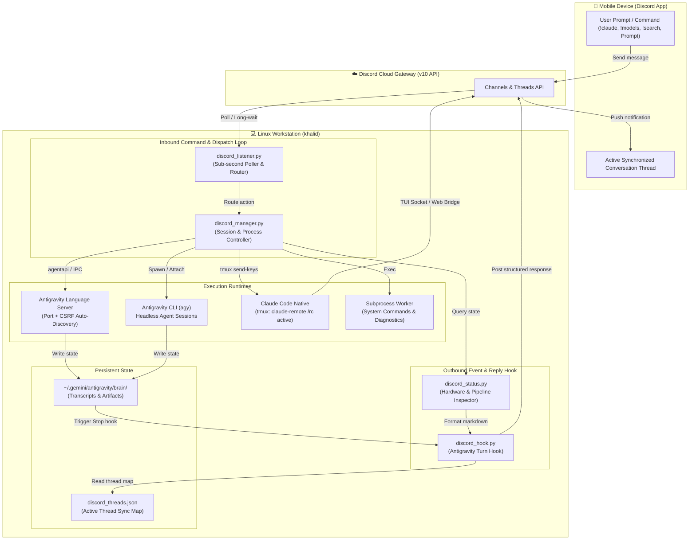
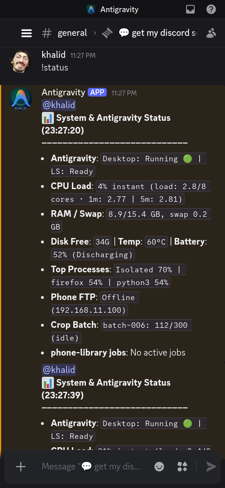
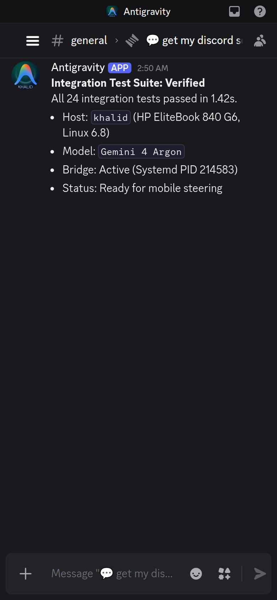

# Workstation Discord Bridge

<div align="center">

**Two-Way Autonomous Agent Steering, Mobile Supervision & Claude Code Remote Control**

[](https://python.org)
[](https://kernel.org)
[](https://discord.com)
[](https://github.com/google)
[-D97757?style=for-the-badge&logo=anthropic&logoColor=white)](https://claude.ai)

</div>

---

## Overview

**Workstation Discord Bridge** connects a Linux development workstation to Discord for fast, bidirectional mobile supervision and steering. It allows you to supervise autonomous AI coding sessions (Google Antigravity desktop app, Claude Code Native), monitor running background jobs, run shell commands, and inspect workstation resources directly from a phone without needing remote desktop software.

- **Desktop ➔ Mobile**: Prompts executed in the Antigravity desktop app automatically stream structured turn completions, code diffs, and test results straight to your phone via lifecycle hooks.
- **Mobile ➔ Workstation**: Send commands or prompts from Discord mobile (`!claude`, `!models`, `!search`, `!status`, `!sh`) to control host runtimes, check quota limits, or steer background agents on the fly.

---

## Architecture & Data Flow

The bridge decouples **inbound mobile commands** (polled via a lightweight background listener) from **outbound agent responses** (pushed automatically on turn completion via lifecycle hooks):



---

## Key Features

### 1. Claude Code Native Remote Control (`!claude` / `!remote`)
- **Direct Remote Session Hook**: Connects to Claude Code's native remote session (`/rc active`) running inside a background tmux session.
- **One-Tap Mobile Handoff**: Posts the live session URL (`https://claude.ai/code/session_...`) for immediate interactive handoff to the Claude iOS/Android app.
- **Terminal Mirroring**: Inspect live terminal outputs directly inside Discord using `!claude pane`.
- **Bidirectional Prompting**: Send `!claude <prompt>` from Discord to pipe instructions straight to Claude Code.

### 2. Multi-Model Quota Monitor (`!models` / `!quota`)
- **Dynamic Language Server Queries**: Queries the local Antigravity Language Server to report remaining quotas and reset schedules.
- **Shared Pool Grouping**: Automatically handles shared quota pools across Gemini 3.8 Flash, Opus 5.5, Sonnet 5.5, and Argon.
- **Fast Response**: Returns accurate usage metrics in under a second directly to your phone.

### 3. Session Archive Search (`!search`)
- **Thread Sync**: Keeps active conversations mapped to clear, navigable Discord threads.
- **Full-Text Archive Search**: Run `!search <query>` to instantly search past sessions, turn histories, and code discussions without opening the desktop app.

### 4. Workstation Telemetry & Process Management (`!status`, `!stop`, `!running`)
- **Host Diagnostics**: Live CPU utilization, memory and swap usage, thermals, battery state, and disk space.
- **Process Supervision**: List active cascades and background tasks (`!running`) and stop runaway processes instantly (`!stop`).
- **Direct Shell Access**: Execute system commands (`!sh <cmd>`) with clean terminal output formatting.

---

## Mobile Command Reference

Commands sent from Discord mobile to supervise and control the host workstation:

| Command | Action & Output |
|---|---|
| `!claude` / `!remote` | Claude Code remote control status, active model, mobile app handoff URL, and working directory. |
| `!claude pane` | Capture and display the live tmux terminal mirror from Claude Code. |
| `!claude <prompt>` | Pipe a command or instruction directly into the active Claude Code session. |
| `!models` / `!quota` | Quota monitor: remaining percentages, shared pools, and UTC reset times. |
| `!search <query>` | Instant full-text search across previous desktop sessions and turn history. |
| `!status` | Host workstation telemetry: CPU load, RAM usage, thermals, battery, and disk. |
| `!running` / `!sessions` | Control center showing running background tasks, active cascades, and CLI jobs. |
| `!stop` / `!cancel` | Terminate background tasks or runaway loops immediately. |
| `!fork` | Fork the current conversation into a new branch thread for isolated exploration. |
| `!sh <command>` | Execute host bash commands with formatted terminal output. |
| `!cli <prompt>` | Launch a headless `agy` CLI turn in the background and stream the output to Discord. |
| `!chats [page]` | Paginated catalog of past conversations. |

---

## 📱 Mobile Supervision Showcase

Screenshots captured from the mobile Discord client during live workstation sessions:

<div align="center">

| 🎛️ Claude Code Remote Control (`!claude`) | 🧠 AI Models Quota Monitor (`!models`) |
|:---:|:---:|
|  <br> *Direct bridge URL for Claude iOS/Android app, working directory, and live steering* |  <br> *Quota percentage check across Gemini 3.8 Flash, Opus 5.5, Sonnet 5.5, and Argon* |

<br>

| 📊 Workstation Telemetry (`!status`) | 🔍 Conversation Archive Search (`!search`) |
|:---:|:---:|
|  <br> *Host hardware metrics: CPU load, RAM and swap, thermals, and battery level* |  <br> *Instant full-text query across past session titles and turns with direct thread links* |

<br>

| 📱 Active Session Controller (`!running`) | 🛑 Emergency Process Cancellation (`!stop`) |
|:---:|:---:|
|  <br> *Overview of active cascades, background tasks, and language server status* |  <br> *Instant termination of runaway tasks and background workers via `!stop`* |

<br>

| 💻 Direct Shell Execution (`!sh`) | 📨 Automated Turn Completion Push |
|:---:|:---:|
|  <br> *Direct host shell command execution returned with formatted terminal styling* |  <br> *Automated turn verification and execution results pushed via lifecycle hook* |

</div>

---

## Repository Structure

```
workstation-discord-bridge/
├── discord_manager.py          # Session controller, Claude remote bridge, and quota manager
├── discord_listener.py         # Sub-second message poller, thread router, and command dispatcher
├── discord_hook.py             # Antigravity turn hook: formats & transmits responses to Discord
├── discord_status.py           # Hardware, systemd, and pipeline telemetry collector
├── discord_send.py             # Standalone CLI utility to send messages to Discord
├── hooks.json.example          # Sample Antigravity hooks configuration
├── discord_config.example.json # Configuration schema template
├── requirements.txt            # Python dependencies
├── docs/
│   └── screenshots/            # Curated mobile captures
├── systemd/
│   └── discord-listener.service# Systemd user service unit for background operation
└── README.md                   # Project documentation
```

---

## Setup & Installation

### 1. Prerequisites
- Linux Workstation (Ubuntu / Debian / Fedora)
- Python 3.10+
- A Discord Bot with Message Content Intent enabled ([Discord Developer Portal](https://discord.com/developers))
- Claude Code Native (`npm install -g @anthropic-ai/claude-code`) or Google Antigravity

### 2. Configuration
Clone the repository and prepare your private configuration:
```bash
git clone https://github.com/kmbenjel/workstation-discord-bridge.git
cd workstation-discord-bridge

# Copy the example config
cp discord_config.example.json discord_config.json
chmod 600 discord_config.json
```

Edit `discord_config.json`:
```json
{
  "bot_token": "YOUR_DISCORD_BOT_TOKEN",
  "guild_id": "YOUR_SERVER_ID",
  "channel_id": "YOUR_MAIN_CHANNEL_ID",
  "user_id": "YOUR_DISCORD_USER_ID"
}
```

### 3. Antigravity Hook Integration
Add the hook to your Antigravity hooks file (`~/.gemini/config/hooks.json`):
```json
{
  "discord-reply-sync": {
    "enabled": true,
    "Stop": [
      {
        "type": "command",
        "command": "/usr/bin/python3 /path/to/workstation-discord-bridge/discord_hook.py",
        "timeout": 15
      }
    ]
  }
}
```

### 4. Running as a Background Systemd Service
To keep the listener running continuously:
```bash
# Copy and enable the service
mkdir -p ~/.config/systemd/user
cp systemd/discord-listener.service ~/.config/systemd/user/
systemctl --user daemon-reload
systemctl --user enable --now discord-listener.service

# Check live logs
journalctl --user -u discord-listener.service -f
```

---

## License & Credits

Built by [Khalid Benjelloun](https://benjelloun.dev) with [Google Antigravity](https://github.com/google) and [Claude Code](https://claude.ai). MIT License.
